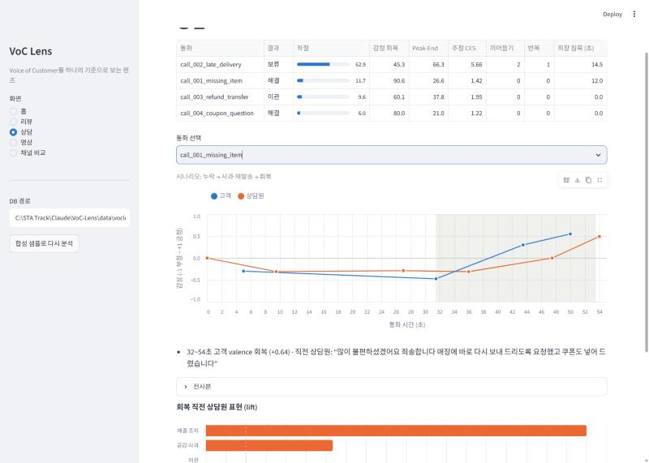
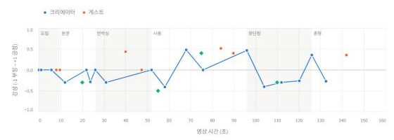
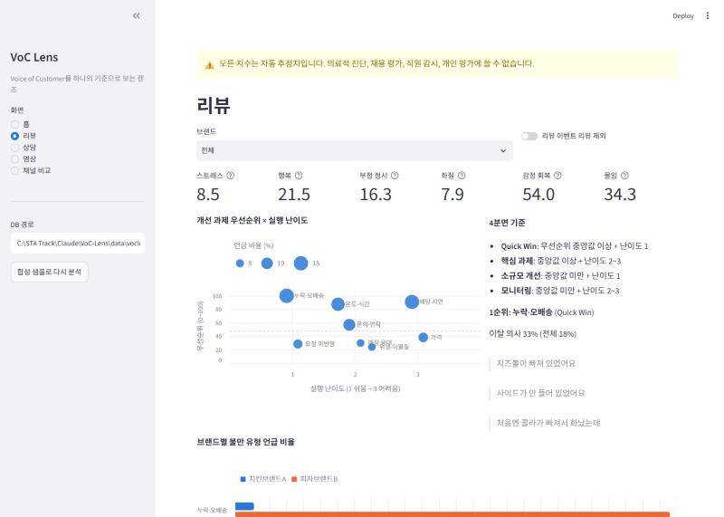
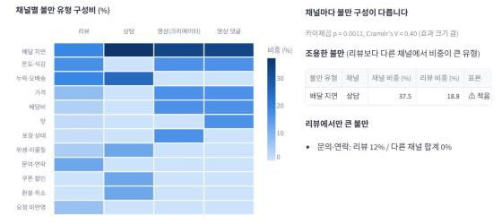

# VoC Lens

**라이브 대시보드: [voc-lens.streamlit.app](https://voc-lens.streamlit.app/)** — 합성 데이터 시연과 함께, **직접 분석** 화면에서 리뷰 CSV·상담 전사본(+WAV)·영상 자막을 올려 바로 분석할 수 있습니다.

포트폴리오 소개 페이지: [docs/index.html](docs/index.html) · PDF [docs/VoC-Lens_portfolio.pdf](docs/VoC-Lens_portfolio.pdf)

**VoC**는 Voice of Customer(고객의 소리)의 약자입니다. 이 도구는 영상·상담 음성·리뷰 세 채널에서 고객의 소리를 하나의 기준으로 들여다봅니다.

영상·상담 음성·리뷰에서 고객의 감정을 추정하고, 그 결과를 **우선순위가 매겨진 CX 개선 과제**로 바꾸는 분석 도구입니다.

> 진행 상황: **8주 계획의 기준선을 모두 구현했습니다** (세 채널 파이프라인, CX 해석, 대시보드, 케이스 스터디, 배포). 공개 실제 데이터(네이버 쇼핑 리뷰 20만 건, KOTE 5만 문장)로 기준선을 평가하고 실제 데이터 케이스를 추가했습니다 → [실제 데이터 평가](docs/evaluation.md). 남은 일은 학습 모델로 교체하는 것입니다. 자세한 일정은 [구현 계획](docs/implementation_plan.md)에 있습니다.

## 왜 만들었나

- 기업의 VoC 분석은 대부분 텍스트를 다루지만, 고객의 실제 감정은 목소리 톤과 대화 흐름에 더 잘 드러납니다.
- 감정 점수가 나와도 "그래서 무엇부터 고칠지"로 이어지지 않는 경우가 많습니다.
- 이 프로젝트는 세 채널(영상, 상담 음성, 리뷰)을 **하나의 지수 체계와 불만 분류 기준**으로 분석하고, 결과를 영향도×난이도 매트릭스로 정리합니다.

## 지수 6개

| 지수 | 의미 | 연결되는 CX 지표 |
|---|---|---|
| 스트레스 | 부정 + 높은 각성 (짜증, 분노) | — |
| 행복 | 긍정 (만족, 기쁨) | CSAT |
| 부정 정서 | 부정 + 낮은 각성 (실망, 체념). 의료 진단이 아님 | — |
| 좌절 | 문제를 해결하느라 애쓴 정도 (반복 문의, 대기) | CES |
| 감정 회복 | 부정 감정이 뒤에서 긍정으로 돌아섰는지 | 서비스 회복, FCR |
| 몰입 | 관심과 열의 (구체성, 재주문·추천 의사) | NPS 성향 |

모든 지수는 Valence(긍정–부정) × Arousal(각성) 모델을 바탕으로 합니다. 정의와 산식은 [PRD 7장](docs/PRD.md)과 [`indices/compute.py`](src/voclens/indices/compute.py)에 있습니다.

## 빠른 시작

```bash
python -m venv .venv
.venv/Scripts/activate          # macOS/Linux: source .venv/bin/activate
pip install -e ".[dev]"

voclens review data/samples/delivery_reviews_synthetic.csv
voclens report --out reports/review_report.md
voclens cx --out reports/cx_report.md
voclens call data/samples/calls
voclens video data/samples/videos
voclens query --list
voclens query complaint_share_by_brand
voclens query recovery_triggers
pytest
```

대시보드:

```bash
pip install -e ".[app]"
streamlit run app/streamlit_app.py
```

DB가 없으면 첫 실행 때 합성 샘플로 세 채널 분석과 CX 추정을 자동으로 합니다. DB 경로를 바꾸거나 샘플을 다시 분석하는 사이드바 기능은 `VOCLENS_DASHBOARD_ADMIN=1` 환경 변수를 켰을 때만 나타납니다 (공개 배포에서 방문자가 서버 경로를 고르거나 데이터를 지우지 못하게).

상담은 전사본 JSON을 읽습니다. 형식은 [상담 전사본 형식](docs/call_transcript_format.md)에 있습니다. 영상은 번들 JSON이나 YouTube URL을 받습니다. 형식은 [영상 입력 형식](docs/video_bundle_format.md)에 있습니다.

리뷰 CSV에는 `text` 열이 필요합니다. `rating`, `created_at`, `brand`, `store`, `owner_reply` 열은 있으면 씁니다. 열 이름은 [configs/default.yaml](configs/default.yaml)에서 바꿉니다.

## 결과 예시

합성 데이터 180건으로 만든 [샘플 리포트](docs/sample_report.md)의 일부입니다. 실제 고객 데이터가 아닙니다.

| 순위 | 불만 유형 | 언급 리뷰 | 이탈 의사 (전체 대비) | 추세 | 난이도 | 4분면 |
|---|---|---|---|---|---|---|
| 1 | 누락·오배송 | 13.3% | 33.3% (18.3%) | +33% | 1 | Quick Win |
| 2 | 배달 지연 | 12.8% | 43.5% (18.3%) | -1% | 3 | 핵심 과제 |
| 3 | 온도·식감 | 11.1% | 35.0% (18.3%) | +24% | 2 | 핵심 과제 |

리포트에는 이 밖에 다음 내용이 들어갑니다.
- 브랜드 간 차이 검정 (카이제곱, Mann-Whitney U, 효과 크기)
- 고객 여정 단계별 감정, 속성별 감성
- 별점–감정 불일치 리뷰
- 리뷰 이벤트 편향 점검

## 상담 분석 흐름

```
전사본 JSON (+ 선택: WAV)
    → 화자 역할 판정 (인사 스크립트·정형 표현으로 상담원/고객 구분)
    → 대화 역학 (발화 점유율, 끼어들기, 침묵, 같은 말 반복, 공감·해결 표현, 통화 결과)
    → 발화 감정 (텍스트)
    → [WAV가 있으면] 피치·에너지·말 속도 → 화자 기준 z-score → 음성 각성 → 융합
    → 고객 발화의 불만 유형·CX 신호
    → 고객 발화만으로 지수 6개, 좌절 지수에 대화 역학 가산
    → 감정 급변 이벤트 + 직전 상담원 발화(회복 계기)
```

융합은 차원마다 가중치가 다릅니다. 각성은 음향 0.7 / 텍스트 0.3, 긍정·부정은 음향 0.3 / 텍스트 0.7입니다. 목소리는 흥분 정도를, 말의 내용은 좋고 나쁨을 더 잘 드러내기 때문입니다. 각 모달의 신뢰도(STT 신뢰도, SNR, 발화 길이)에 따라 가중치가 줄어듭니다.

합성 상담 4건의 결과입니다. 실제 상담이 아니며, 시나리오대로 나오는지 확인하는 용도입니다.

| 통화 | 결과 | 좌절 | 감정 회복 | Peak-End | 끼어들기 | 반복 |
|---|---|---|---|---|---|---|
| 누락 → 사과·재발송 | 해결 | 11.7 | 90.6 | 26.6 | 0 | 0 |
| 지연 → 반복 문의 | 보류 | 62.9 | 45.3 | 66.3 | 2 | 1 |
| 이물질 환불 | 이관 | 9.6 | 60.1 | 37.8 | 0 | 0 |
| 쿠폰 문의 | 해결 | 6.0 | 80.0 | 21.0 | 0 | 0 |

회복 계기 분석은 고객 감정이 크게 오르기 직전의 상담원 발화를 모아 표현 유형별 lift를 계산합니다. 첫 통화에서는 "다시 보내 드리도록 요청했고 쿠폰도 넣어 드렸습니다"가 계기로 잡혔습니다.

## 케이스 스터디

사례 1~3은 합성 데이터, 사례 4는 공개 실제 데이터로 CX 질문에 답했습니다. → [케이스 스터디 목록](docs/case_studies/README.md)

| # | 질문 | 핵심 발견 |
|---|---|---|
| [1](docs/case_studies/01_delivery_brand_comparison.md) | 두 배달 브랜드는 무엇을 먼저 고쳐야 하나? | 감정 점수는 차이가 없지만(p = 0.52) 불만 구성은 크게 다름(Cramér's V = 0.74). A는 온도·식감이 핵심 과제, B는 누락이 Quick Win |
| [2](docs/case_studies/02_call_quality_recovery.md) | 어떤 상담이 고객을 지치게 하고, 무엇이 감정을 회복시키나? | 끼어들기·반복·대기가 좌절을 키움(좌절 62.9, CES 5.66). 회복 계기는 "사과 + 구체적 조치"를 한 번에 말한 발화 |
| [3](docs/case_studies/03_cross_channel_chicken_a.md) | 리뷰만 보면 놓치는 것이 있나? | 배달 지연은 리뷰·영상·댓글 모두에서 1~2위 → 브랜드 공통 과제. 타임스탬프 댓글이 시청자가 반응한 장면을 보여줌 |
| [4](docs/case_studies/04_online_shopping_reviews.md) | **(실제 데이터)** 온라인 쇼핑 리뷰 4만 건에서 무엇을 먼저 고쳐야 하나? | 양은 제품 품질(1~2점 리뷰의 24.7%)이지만, 오배송·누락은 1점 비율 44.9%에 난이도 1 → Quick Win. 재구매 고객은 실망하면 51.9%가 1점(신규 35.1%), 원인은 신선식품 품질 편차 |

## 대시보드

배포 방법은 [대시보드 배포](docs/deploy.md)에 있습니다. 첫 방문 시 합성 샘플 데이터로 DB를 자동으로 만듭니다.

사이드바는 **홈(예시 결과) / 직접 분석 / 분석 기준** 세 화면입니다. 분석 기준의 **정확도** 탭에서 실제 데이터로 잰 정확도를 볼 수 있고, 직접 분석 결과에는 도메인별 신뢰도 안내가 붙습니다. 홈은 직접 분석을 하면 결과가 어떻게 나오는지 합성 데이터로 미리 보여주며, 아래 다섯 탭으로 나뉩니다. 모든 화면 맨 위에 "자동 추정치이며 진단·개인 평가 용도가 아니다"라는 고지가 고정되어 있습니다. 아래 화면은 합성 데이터로 만든 것입니다.

| 홈의 탭 · 사이드바 화면 | 내용 |
|---|---|
| 요약 | 채널별 추정 CSAT%·CES·NPS 성향, 우선 개선 과제, 조용한 불만, CSAT 모델 검증 요약 |
| 리뷰 | 브랜드·리뷰 이벤트 필터, 지수 6개(신뢰구간), 우선순위 × 난이도 4분면, 브랜드별 불만 비율, 여정 단계·속성별 감성, 별점–감정 불일치 |
| 상담 | 통화 목록(좌절·회복·CES), 고객·상담원 감성 시간축과 감정 급변 구간, 회복 계기(직전 상담원 발화), 전사본, 회복 직전 표현 lift |
| 영상 | 문장 감성 시간축 + 내용 구간 + 타임스탬프 댓글, 구간 요약, 크리에이터 vs 시청자 감성 |
| 채널 비교 | 도메인 선택, 채널별 CX 지표, 불만 유형 구성비 히트맵, 조용한 불만, CSAT 모델 검증 |
| **직접 분석** (사이드바) | 리뷰 CSV(열 자동 추정, UTF-8·CP949), 상담 전사본(텍스트 `화자: 발화` 붙여 넣기 / JSON, 같은 이름의 WAV면 음향 분석 추가), 영상 자막(VTT·SRT)+댓글 / 번들 JSON / YouTube 주소. 방문자 전용 메모리 DB에서 분석하고 저장하지 않음 |
| **분석 기준** (사이드바) | 감정 사전과 7감정 좌표, 지수 공식, 불만 분류표(21개 소분류), CX 신호, 상담·영상 규칙, CX 추정 공식. 설정 파일에서 바로 만들어 실제 규칙과 항상 같음 |

모든 결과 화면에 **문장별 판단 근거**가 있습니다. 문장마다 어떤 표현 때문에 그 감정·불만 유형·CX 신호로 판단했는지 보여줍니다 (예: "1시간 만에 왔네요" → 배달 지연 ← '1시간 만에'(불만 표현), 대기 ← '1시간'). 화면 아래 **이 화면의 분석 기준**에서 그 화면에 쓰인 규칙을 볼 수 있습니다.









차트 색은 개체에 고정합니다. 채널은 리뷰=파랑, 상담=주황, 영상=청록이고, 감성은 파랑(긍정)↔빨강(부정)입니다. 모든 차트는 축 하나이고, 마우스를 올리면 값이 보이는 툴팁이 있습니다.

## 채널 통합 CX 해석

`voclens cx`는 세 채널의 분석 결과를 모아 CX 지표를 추정하고 채널을 비교합니다. [샘플 CX 리포트](docs/sample_cx_report.md)에서 결과를 볼 수 있습니다.

| 지표 | 추정 방법 |
|---|---|
| **CSAT** | 리뷰 별점을 정답 대용으로 써서 릿지 회귀를 학습한 뒤 상담·영상에 적용합니다. 특징은 감정, 지수, CX 신호 13개입니다. 만족 비율(4점 이상)의 기준값은 학습 데이터의 실제 만족 비율에 맞춰 보정합니다 |
| **CES** | 좌절 지수 60%, 반복 문의 20%, 대기 10%, 미해결(보류·이관) 10%로 1(쉬움)~7(어려움) 점수를 만듭니다 |
| **NPS 성향** | 추천·재주문 의사는 추천 고객, 이탈·비추천 의사는 비추천 고객입니다. 표현이 없으면 "판단 불가"로 두고 판단 가능 비율을 함께 보여줍니다 |

채널 비교는 원점수가 아니라 **불만 유형 구성비**로 합니다. 리뷰는 긍정 쪽으로, 상담은 부정 쪽으로 치우쳐 있기 때문입니다.
- **조용한 불만:** 상담이나 영상 댓글에서는 비중이 큰데 리뷰에서는 작은 유형을 찾습니다. 리뷰만 보면 놓치는 불만입니다.
- **리뷰에서만 큰 불만:** 반대로 리뷰에서만 비중이 큰 유형입니다.
- **도메인 분리:** 같은 도메인(배달 / 제품)끼리만 비교합니다.
- **소표본 표시:** 불만 언급이 20건 미만인 채널은 "표본 적음"으로 표시합니다.

합성 리뷰로 검증한 CSAT 모델 결과입니다. 학습에 쓰지 않은 리뷰 38건으로 평가했고, 실제 데이터 성능이 아닙니다.

| 모델 | 별점 예측 MAE |
|---|---|
| 상수 기준선 (평균 별점) | 1.236 |
| Valence 하나만 쓰는 회귀 | 0.697 |
| 전체 특징 릿지 회귀 | **0.564** (Spearman ρ 0.70) |

## 영상 분석 흐름

```
번들 JSON 또는 YouTube URL (사람이 단 자막만 사용, 댓글은 Data API)
    → 문장 분리 + 시각 보간, 구독·좋아요 같은 상투 문구 제거
    → 주 화자(크리에이터) 판정
    → 문장 감정, [WAV가 있으면] 음향 각성 융합과 말–톤 불일치 표시
    → 불만 유형·속성 (영상 도메인에 맞는 분류만: 제품 / 배달)
    → 내용 구간 분할 (TextTiling) → 도입·언박싱·사용·장단점·총평
    → 영상 유형 (리뷰·브이로그·인터뷰·상담 재연·뉴스)
    → 댓글 감정·불만 유형, "3:20" 타임스탬프 → 구간 연결
    → 크리에이터 지수, 총평 가중 Valence, 시청자 지수, 시청자 반응 기반 몰입 지수
```

합성 무선청소기 리뷰 영상의 구간 결과입니다. 실제 영상이 아닙니다.

| 구간 | 시간 | Valence | 주요 속성 | 타임스탬프 댓글 | 댓글 Valence |
|---|---|---|---|---|---|
| 도입 | 0:00~0:16 | 0.00 | — | 0 | — |
| 언박싱 | 0:20~1:06 | +0.20 | 포장, 배터리, 디자인 | 1 | +0.52 |
| 사용 | 1:06~1:42 | +0.19 | 성능, 사용성 | 2 | +0.40 |
| 사용 | 1:42~2:38 | -0.14 | 배터리, 성능 | 2 | -0.33 |
| 장단점 | 2:38~3:34 | -0.11 | 가격, 디자인, 사용성 | 1 | -0.30 |
| 총평 | 3:34~4:04 | +0.16 | 배터리 | 0 | — |

크리에이터가 배터리·소음을 말한 구간(1:42~)을 시청자도 타임스탬프 댓글로 짚었습니다. 이 구간에서는 시청자 감정도 함께 부정으로 바뀝니다.

## 리뷰 분석 흐름

```
CSV → 정제 (반복 문자, 이모티콘 → 감정 토큰, 개인정보 마스킹, 리뷰 이벤트 표시)
    → 절 분리 ("맛은 좋은데 / 배달이 늦어요")
    → 감정 (7감정 → Valence·Arousal)
    → 불만 유형·속성 (분류 기준 17개 소분류)
    → CX 신호 (재주문·이탈·추천 의사, 반복 문의, 대기, 해결)
    → 고객 여정 단계
    → 지수 6개 + Peak-End + 채널 내 백분위
    → SQLite → SQL 집계 / 개선 과제 리포트
```

지금의 감정·불만 분류는 **사전·규칙 기반 기준선**입니다. 2주차에 능동 학습으로 라벨을 만들고 파인튜닝 모델로 바꿉니다. 그 뒤 기준선과의 성능 비교를 [experiments/](experiments/README.md)에 기록합니다. 분류기 인터페이스는 그대로라서 모델만 바꾸면 됩니다. 임베딩 Zero-shot 분류기와 능동 학습 순위 함수는 이미 [`text/taxonomy.py`](src/voclens/text/taxonomy.py)에 있습니다.

## 실제 데이터 평가

규칙 기반 기준선이 실제 데이터에서 어디까지 맞는지 공개 데이터로 쟀습니다. 규칙은 개발용 80%만 보고 고치고, 지표는 평가용 20%로 냈습니다. → [실제 데이터 평가](docs/evaluation.md)

| 평가 | 결과 |
|---|---|
| 네이버 쇼핑 평가용 39,807건: 1~2점 리뷰에 불만 유형이 붙은 비율 | 분류 기준 v0.2.1 15% → **v0.3.0 35%** (쇼핑 유형 10개 추가, 부정 처리) |
| 같은 데이터: 리뷰 감성으로 고득점·저득점을 가르는 AUC | 0.856 |
| KOTE 5천 문장: 감정 사전의 극성 정확도 | 판단한 문장에서 72.5%(긍정 91%, 부정 57%), 감정 표현 검출 44% → 부정 감정을 많이 놓친다 |
| 라벨링한 평가 세트 337개 절 (무작위, 규칙을 못 본 Claude 라벨러 2명, κ 0.96) | 불만 여부 F1 0.14 → **0.46** (정밀도 0.80, 재현율 0.32), 유형 micro F1 0.41 |
| **학습한 감정 모델** (KOTE 4만 문장, koelectra-small, CPU 67분) | KOTE 극성 AUC 0.71 → **0.98**, 부정 문장 정확도 57% → **99%**. 쇼핑 평가 세트 불만 여부 F1 0.46 → **0.54** (재현율 0.32 → 0.44, 정밀도 0.80 → 0.70) |

감정 사전 기준선은 잡으면 대체로 맞지만(정밀도 0.80) 불만 3개 중 2개를 놓칩니다. 감성 점수를 학습 모델로 바꾸면 놓치는 불만이 줄지만 오탐이 늘어서, 서비스 목적(모니터링 vs 보고)에 따라 고릅니다. 배포 화면은 아직 감정 사전이고, 학습 모델은 CLI의 `--emotion-model`로 씁니다. 평가 세트 라벨은 사람이 아니라 Claude가 붙였고, 사람 검수는 진행 중입니다.

## 저장소 구조

```
configs/            분류 기준, 감정·CX 신호 사전, 여정 단계, 기본 설정
src/voclens/
  text/             정제, 절 분리, 감정, 불만 유형, 여정 단계, CX 신호
  audio/            화자 역할 판정, 대화 역학, 음향 특징, 음성 각성, STT·화자 분리 어댑터
  video/            영상 유형, 내용 구간 분할, 타임스탬프 댓글
  fusion/           음향 + 텍스트 융합
  indices/          지수 계산, 상담 지수, 감정 급변 탐지
  cx/               통계, 개선 과제 리포트, 회복 계기 분석, CSAT·CES·NPS 추정, 채널 비교
  store/            SQLite 스키마, SQL 집계 쿼리
  dashboard/        대시보드용 데이터 조회와 차트 (Streamlit 없이 테스트 가능)
  ingest/           리뷰 CSV, 상담 전사본, 자막(VTT/SRT), YouTube
  pipelines/        채널별 파이프라인 (리뷰, 상담, 영상)
  templates/        리포트 템플릿
app/                Streamlit 대시보드
labeling/           라벨링 기준서, Label Studio 설정
scripts/            합성 데이터 생성기, 공개 데이터 내려받기, 케이스 4 집계
docs/               PRD, 분석 설계서, 구현 계획, 데이터 신청 목록, 분류 기준
tests/              단위·통합 테스트
```

## 로드맵

| 주차 | 내용 | 상태 |
|---|---|---|
| 1 | 리뷰 파이프라인 기준선, 분류 기준 v0.1, SQL 집계, 개선 과제 리포트 | 완료 |
| 2 | 능동 학습 라벨링, 감정·ABSA·불만 유형 파인튜닝 (Colab) | 진행 중 (평가 세트 라벨링, KOTE 감정 모델 학습 완료. 불만 유형 분류기는 예정) |
| 3 | 상담 음성: STT, 화자 분리·역할 판정, 음성 감정 | 기준선 완료 (음향 규칙 기준선, STT·화자 분리는 어댑터만, 학습 SER은 데이터 승인 후) |
| 4 | 대화 흐름 지표, 음성·텍스트 융합, 감정 급변 탐지 | 기준선 완료 (융합 가중치 학습, 사람 점수와의 상관 검증은 데이터 승인 후) |
| 5 | 영상: 자막·STT, 구간 분할, 타임스탬프 댓글 연결 | 기준선 완료 (실제 YouTube 수집은 API 키 발급 후 확인) |
| 6 | CSAT·CES·NPS 추정, 채널 비교, 회복 계기 분석 | 기준선 완료 (상담 데이터로 CSAT 별도 검증은 데이터 승인 후) |
| 7 | Streamlit 대시보드, 검증 결과 정리 | 대시보드 완료 (검증 결과 정리는 학습 모델 교체 후) |
| 8 | 케이스 스터디, 배포 | 완료 (합성 데이터 사례 3건, 배포. 공개 실제 데이터 사례 1건과 기준선 평가 추가) |

## 데이터와 윤리

- 저장소에는 합성 데이터만 있습니다. AI Hub 등 외부 데이터는 재배포할 수 없어서 넣지 않습니다. 신청 방법은 [데이터 신청 목록](docs/data_sources.md)에 있습니다.
- 공개 데이터(네이버 쇼핑 리뷰 Public Domain, KOTE MIT)도 원문은 넣지 않고 `scripts/fetch_public_data.py`로 내려받습니다. 저장소에는 원문 없는 지표만 둡니다.
- 배달앱·쇼핑몰은 크롤링하지 않습니다. 리뷰는 정당하게 확보한 CSV나 공개 데이터셋만 씁니다.
- 원문은 개인정보(전화번호, 이메일, 긴 숫자)를 가린 뒤 저장합니다.
- 지수는 추정치입니다. 의료 진단, 채용 평가, 직원 감시, 개인 평가에 쓸 수 없습니다.

## 문서

- [PRD](docs/PRD.md)
- [분석 설계서](docs/analysis_design.md)
- [구현 계획](docs/implementation_plan.md)
- [데이터 신청 목록](docs/data_sources.md)
- [케이스 스터디](docs/case_studies/README.md)
- [실제 데이터 평가](docs/evaluation.md)
- [대시보드 배포](docs/deploy.md)
- [샘플 리뷰 리포트](docs/sample_report.md) / [샘플 CX 리포트](docs/sample_cx_report.md)
- [VoC 불만 유형 분류 기준](docs/voc_taxonomy.md)
- [상담 전사본 형식](docs/call_transcript_format.md)
- [영상 입력 형식](docs/video_bundle_format.md)
- [라벨링 기준서](labeling/guidelines.md)
